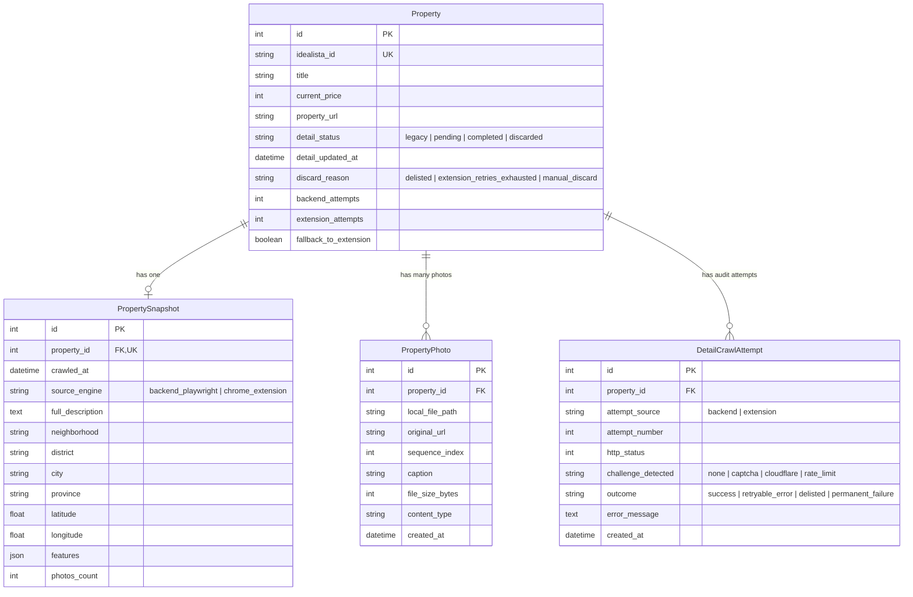
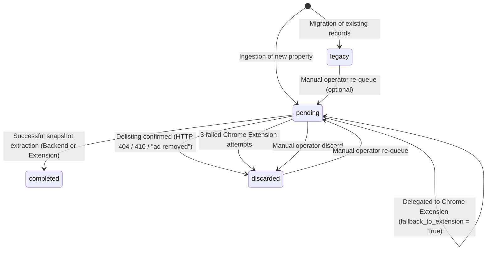

# Phase 1 Data Model: Full Property Snapshot Crawler

**Feature**: Full Property Snapshot Crawler  
**Branch**: `006-full-property-crawl`  
**Date**: 2026-10-17  

## Entity Relationship Overview

---

## Detailed Entity Specifications

### 1. `Property` (Extended Existing Model)

The core `Property` table in `src/database/models.py` is extended with state tracking and retry management for full detail crawling.

| Field Name | Type | Nullable | Default | Description |
|---|---|:---:|---|---|
| `detail_status` | `String(20)` | No | `'legacy'` | Lifecycle state: `'legacy'`, `'pending'`, `'completed'`, `'discarded'`. Indexed. |
| `detail_updated_at` | `DateTime` | Yes | `NULL` | UTC timestamp of last status change or successful crawl. |
| `discard_reason` | `String(50)` | Yes | `NULL` | Explicit reason when discarded: `'delisted'`, `'extension_retries_exhausted'`, `'manual_discard'`. |
| `backend_attempts` | `Integer` | No | `0` | Number of attempts performed by the backend Playwright crawler. |
| `extension_attempts` | `Integer` | No | `0` | Number of attempts performed by the Chrome extension fallback tier. |
| `fallback_to_extension` | `Boolean` | No | `False` | Set to `True` when backend encounters persistent anti-bot friction, flagging for extension pickup. |

**Invariants & Validation Rules**:
- Pre-existing records during migration are automatically set to `detail_status = 'legacy'`.
- Any new property created via email alerts or basic search crawls MUST be initialized with `detail_status = 'pending'`, `backend_attempts = 0`, `extension_attempts = 0`, and `fallback_to_extension = False`.
- `discard_reason` MUST be populated whenever `detail_status` is updated to `'discarded'`.

---

### 2. `PropertySnapshot` (New Table: `property_snapshot`)

Stores the comprehensive textual and structured attributes extracted from the listing page.

| Field Name | Type | Nullable | Default | Description |
|---|---|:---:|---|---|
| `id` | `Integer` | No | PK, Auto | Primary key. |
| `property_id` | `Integer` | No | FK | Foreign key to `property.id`. Unique (1-to-1). Cascades on delete. |
| `crawled_at` | `DateTime` | No | UTC Now | Timestamp when the snapshot was successfully extracted and stored. |
| `source_engine` | `String(30)` | No | - | Engine that captured the data: `'backend_playwright'` or `'chrome_extension'`. |
| `full_description` | `Text` | No | - | Complete textual listing description as published by the seller/agent. |
| `neighborhood` | `String(255)` | Yes | `NULL` | Granular neighborhood name (e.g., "Malasaña"). |
| `district` | `String(255)` | Yes | `NULL` | District name (e.g., "Centro"). |
| `city` | `String(255)` | Yes | `NULL` | Municipality / City (e.g., "Madrid"). |
| `province` | `String(255)` | Yes | `NULL` | Province (e.g., "Madrid"). |
| `latitude` | `Float` | Yes | `NULL` | Geographical latitude coordinate if published. |
| `longitude` | `Float` | Yes | `NULL` | Geographical longitude coordinate if published. |
| `features` | `JSON` | Yes | `NULL` | Key-value amenities and attributes (e.g., air conditioning, terrace, heating, energy rating, condition). |
| `photos_count` | `Integer` | No | `0` | Total number of gallery photos saved in `property_photo`. |

---

### 3. `PropertyPhoto` (New Table: `property_photo`)

Stores metadata and local filesystem references for all downloaded gallery photos.

| Field Name | Type | Nullable | Default | Description |
|---|---|:---:|---|---|
| `id` | `Integer` | No | PK, Auto | Primary key. |
| `property_id` | `Integer` | No | FK | Foreign key to `property.id`. Cascades on delete. |
| `local_file_path` | `String(500)` | No | - | Relative path to image file in media storage (`properties/{idealista_id}/{filename}`). |
| `original_url` | `String(1000)`| No | - | Source CDN URL at the time of extraction. |
| `sequence_index` | `Integer` | No | `0` | 0-indexed display sequence as shown on the original web gallery. |
| `caption` | `String(255)` | Yes | `NULL` | Photo caption or title if published by the listing. |
| `file_size_bytes` | `Integer` | Yes | `NULL` | Binary image size in bytes on disk. |
| `content_type` | `String(50)`  | No | `'image/jpeg'` | MIME type of the saved image file. |
| `created_at` | `DateTime` | No | UTC Now | Timestamp when the image file was downloaded and stored. |

**Invariants**:
- The combination of `(property_id, sequence_index)` should be unique.
- Files referenced by `local_file_path` MUST exist on disk before the `PropertyPhoto` row is committed.

---

### 4. `DetailCrawlAttempt` (New Table: `detail_crawl_attempt`)

Maintains an immutable audit trail of every crawl attempt across both tiers for observability and retry tracking.

| Field Name | Type | Nullable | Default | Description |
|---|---|:---:|---|---|
| `id` | `Integer` | No | PK, Auto | Primary key. |
| `property_id` | `Integer` | No | FK | Foreign key to `property.id`. Cascades on delete. |
| `attempt_source` | `String(20)` | No | - | Execution origin: `'backend'` or `'extension'`. |
| `attempt_number` | `Integer` | No | `1` | Sequential attempt counter for this property and source. |
| `http_status` | `Integer` | Yes | `NULL` | HTTP response code received (e.g. 200, 403, 404, 429). |
| `challenge_detected` | `String(30)` | No | `'none'` | Anti-bot indicator: `'none'`, `'captcha'`, `'cloudflare'`, `'rate_limit'`. |
| `outcome` | `String(30)` | No | - | Result: `'success'`, `'retryable_error'`, `'delisted'`, `'permanent_failure'`. |
| `error_message` | `Text` | Yes | `NULL` | Detailed error message or exception trace snippet. |
| `created_at` | `DateTime` | No | UTC Now | Timestamp of attempt execution. |

---

## State Machine: Detail Crawl Lifecycle

### Transition Matrix

| Current State | Event / Trigger | Next State | Actions & Side Effects |
|---|---|---|---|
| *Pre-existing* | System Migration | `legacy` | Sets `detail_status = 'legacy'`. Excluded from crawl workers. |
| *New Property* | Discovery Ingestion | `pending` | Sets `detail_status = 'pending'`, `backend_attempts = 0`. Added to crawl queue. |
| `pending` | Extraction Success | `completed` | Saves `PropertySnapshot`, saves all `PropertyPhoto` records, updates `detail_updated_at`. |
| `pending` | Backend Bot Challenge | `pending` | Increments `backend_attempts`. If `>= 3`, sets `fallback_to_extension = True`. Applies backoff delay. |
| `pending` | Delisting Confirmed | `discarded` | Sets `detail_status = 'discarded'`, `discard_reason = 'delisted'`. Logs attempt. |
| `pending` | Extension 3rd Failure | `discarded` | Sets `detail_status = 'discarded'`, `discard_reason = 'extension_retries_exhausted'`. Logs attempt. |
| `pending` | Admin Manual Discard | `discarded` | Sets `detail_status = 'discarded'`, `discard_reason = 'manual_discard'`. |
| `discarded` | Admin Manual Requeue | `pending` | Resets `backend_attempts = 0`, `extension_attempts = 0`, `fallback_to_extension = False`. |
