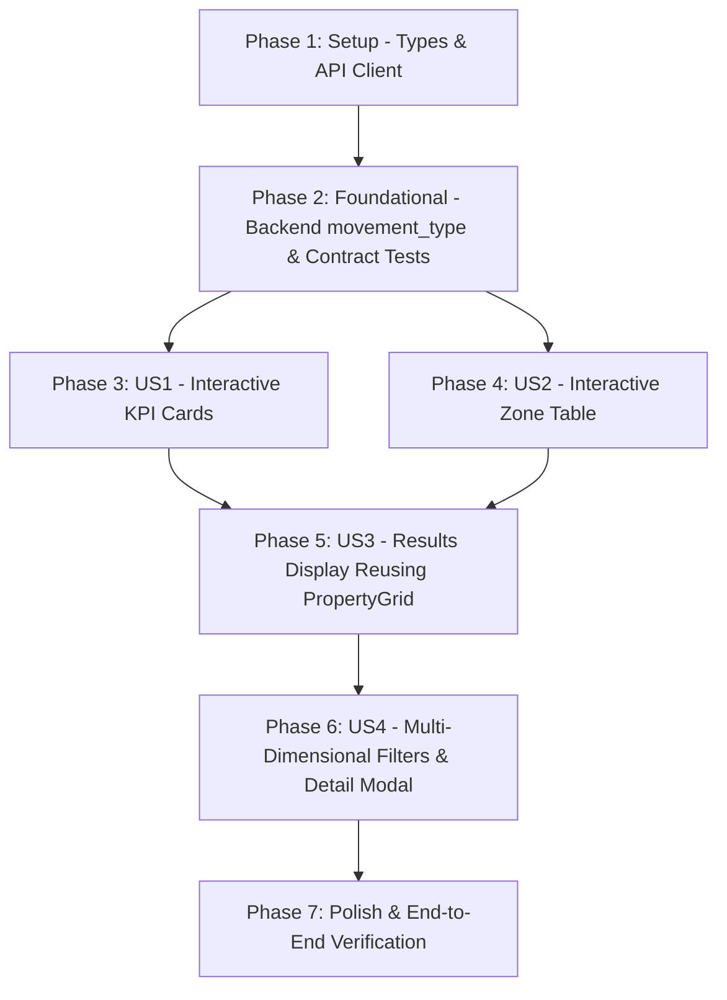

# Tasks: Interactive Interval KPI & Zone Filters with Property Drilldown

**Input**: Design documents from `specs/008-interval-filters-drilldown/` (`spec.md`, `plan.md`, `data-model.md`, `contracts/api-contracts.md`, `quickstart.md`)  
**Feature Branch**: `008-interval-filters-drilldown`  
**Tests**: Included as contract and component tests per constitution standards.  
**Organization**: Tasks are grouped by user story to enable independent implementation and testing of each story.

---

## Format: `- [ ] [TaskID] [P?] [Story?] Description with file path`

- **[P]**: Can run in parallel (different files, no dependencies)
- **[Story]**: Which user story this task belongs to (e.g., US1, US2, US3, US4)
- Include exact file paths in descriptions

---

## Phase 1: Setup (Shared Infrastructure)

**Purpose**: Project initialization, types, and client API definitions.

- [X] T001 Define `IntervalMetricType` (`'inclusions' | 'sales' | 'price_drops' | 'price_increases' | 'all'`), extend `PropertyQueryParams` with optional `movement_type`, and declare `IntervalDrilldownFilterState` in `frontend/src/types/property.ts`.
- [X] T002 [P] Update `api.getProperties` in `frontend/src/services/api.ts` to serialize and append the optional `movement_type` parameter to the `/properties` query string.

---

## Phase 2: Foundational (Blocking Prerequisites)

**Purpose**: Backend support for filtering properties by market dynamic movement types within intervals.

**⚠️ CRITICAL**: Foundational tasks must be completed before user stories can execute backend-dependent drilldown tests.

- [X] T003 [P] Create backend contract tests in `tests/contract/test_interval_properties_contract.py` asserting that `GET /api/v1/properties` with `movement_type` (`inclusions`, `sales`, `price_drops`, `price_increases`), `date_from`, `date_to`, and `zone` returns status 200 and correctly filtered schemas.
- [X] T004 Implement `movement_type` filtering logic in `src/services/property_service.py` to filter properties by `first_seen_at` for inclusions, `sold_at` for sales, and subqueries on `PriceHistory` for price drops and price increases in `[date_from, date_to]`.
- [X] T005 Update the route handler `list_properties` in `src/api/routes/properties.py` to accept the optional `movement_type: Optional[str] = Query(None)` parameter and forward it to `PropertyService.list_properties`.

**Checkpoint**: Backend API foundation ready — `GET /api/v1/properties?movement_type=...` can now be queried for all interval drilldown scenarios.

---

## Phase 3: User Story 1 - Interactive Metric Cards as Dynamic Filters (Priority: P1) 🎯 MVP

**Goal**: Make the 4 primary KPI cards (*Inclusiones*, *Ventas Concluidas*, *Rebajas de Precio*, *Aumentos de Precio*) clickable with active highlight styling, allowing toggling and selecting a market movement filter.

**Independent Test**: Click "Ventas Concluidas" card in the Interval Audit view; verify the card highlights with an active ring/border, and clicking it a second time deselects it.

### Tests for User Story 1
- [X] T006 [P] [US1] Create unit tests in `frontend/src/components/intervals/__tests__/IntervalMetricCards.test.tsx` asserting that clicking metric cards calls `onSelectMetric` with `'inclusions'`, `'sales'`, `'price_drops'`, and `'price_increases'`, and applies active visual classes when `selectedMetric` is set.

### Implementation for User Story 1
- [X] T007 [US1] Extend `frontend/src/components/intervals/IntervalMetricCards.tsx` with `selectedMetric?: IntervalMetricType | null` and `onSelectMetric?: (metric: IntervalMetricType) => void` props, adding clickable cursor, hover border transitions, keyboard accessibility, and active selection state styles (`ring-2 ring-indigo-500 bg-indigo-50/20 dark:bg-indigo-950/30`).

**Checkpoint**: At this point, User Story 1 UI components are fully interactive, testable, and provide clear visual feedback on selection.

---

## Phase 4: User Story 2 - Territorial Zone Table Interactive Filtering (Priority: P1)

**Goal**: Make zone rows in the territorial dynamic breakdown table interactive so clicking a zone filters listings by that specific neighborhood and highlights the selected row.

**Independent Test**: In the territorial breakdown table, click on the "Gamonal" row; verify the row is highlighted with a distinctive border/background, and clicking it again deselects it.

### Tests for User Story 2
- [X] T008 [P] [US2] Create unit tests in `frontend/src/components/intervals/__tests__/IntervalZoneTable.test.tsx` asserting that clicking a table row calls `onSelectZone` with the row's zone name, toggles to null when clicking an already selected zone, and applies the selected row styling.

### Implementation for User Story 2
- [X] T009 [US2] Extend `frontend/src/components/intervals/IntervalZoneTable.tsx` with `selectedZone?: string | null` and `onSelectZone?: (zone: string) => void` props, adding pointer cursor, hover effects, and active row styling (`border-l-4 border-indigo-600 bg-indigo-50/70 dark:bg-indigo-950/40 font-semibold`).

**Checkpoint**: At this point, User Stories 1 and 2 allow interactive selection of both metric categories and territorial zones.

---

## Phase 5: User Story 3 - Results Display Reusing Main Explorer Grid Component (Priority: P2)

**Goal**: Render the filtered drilldown properties directly below the territorial table in the Interval tab by strictly reusing `PropertyGrid` and `PropertyCard`, supporting pagination and empty state handling.

**Independent Test**: Apply a filter (e.g. "Rebajas de Precio"); verify that `PropertyGrid` renders below the table showing properties with photos, prices, discount badges, and working pagination.

### Tests for User Story 3
- [X] T010 [P] [US3] Create integration tests in `frontend/src/components/intervals/__tests__/IntervalDrilldownGrid.test.tsx` verifying that `PropertyGrid` renders drilldown properties with total count, empty state reset action, and pagination callbacks.

### Implementation for User Story 3
- [X] T011 [US3] In `frontend/src/App.tsx`, introduce interval drilldown state (`intervalMetric`, `intervalZone`, `intervalProperties`, `intervalTotal`, `intervalOffset`, `isLoadingDrilldown`), fetch drilldown properties via `api.getProperties`, and render `<PropertyGrid>` below `IntervalZoneTable` in the intervals tab with an active filter summary bar and pagination controls.

**Checkpoint**: Filtered properties are displayed inline with full component reuse from the main explorer page.

---

## Phase 6: User Story 4 - Multi-Dimensional Combinations & Property Detail Modal (Priority: P2)

**Goal**: Allow simultaneous combination of KPI Card filter + Zone filter, preserve filter intentions across interval date changes, and open `PropertyDetailModal` on card clicks.

**Independent Test**: Click "Rebajas de Precio" and select "Burgos Centro"; verify results match both filters. Click a property card; verify `PropertyDetailModal` opens showing photos and historical timeline.

### Implementation for User Story 4
- [X] T012 [US4] In `frontend/src/App.tsx`, integrate multi-dimensional filtering (`intervalMetric` + `intervalZone`), auto-reset pagination offset to 0 on any filter change, and refresh drilldown results whenever `intervalStart` or `intervalEnd` changes.
- [X] T013 [US4] Wire `onSelectProperty={setSelectedProperty}` on the interval `<PropertyGrid>` in `frontend/src/App.tsx`, connecting to the existing root `<PropertyDetailModal>` to display complete listing details and price history.

**Checkpoint**: All user stories functional and integrated.

---

## Phase 7: Polish & Cross-Cutting Concerns

**Purpose**: Validation, linting, formatting, and end-to-end verification.

- [X] T014 [P] Run code quality checks: `cd frontend && npm run build` and `oxlint` on frontend, and `ruff check src/ tests/` on backend.
- [X] T015 Run automated backend and frontend test suites (`pytest tests/contract/test_interval_properties_contract.py` and `cd frontend && npm test`).
- [X] T016 Execute manual end-to-end verification following all validation scenarios documented in `specs/008-interval-filters-drilldown/quickstart.md`.

---

## Dependencies & Execution Order

### Phase Dependencies

- **Setup (Phase 1)**: No dependencies — can start immediately.
- **Foundational (Phase 2)**: Depends on Phase 1 — BLOCKS all backend-dependent user story drilldown queries.
- **User Story 1 (Phase 3)**: Depends on Phase 1 & 2 — Can run in parallel with User Story 2.
- **User Story 2 (Phase 4)**: Depends on Phase 1 & 2 — Can run in parallel with User Story 1.
- **User Story 3 (Phase 5)**: Depends on User Stories 1 and 2 (needs filter state to drive results display).
- **User Story 4 (Phase 6)**: Depends on User Story 3 (combines filters and wires modal interaction).
- **Polish (Phase 7)**: Depends on all user stories completed.

---

## Parallel Opportunities

- **Phase 1**: `T001` and `T002` can run in parallel.
- **Phase 2 & Phase 3**: `T003` (backend contract test) and `T006` (frontend cards unit test) can run in parallel.
- **User Stories 1 & 2**: `T007` (`IntervalMetricCards.tsx`) and `T009` (`IntervalZoneTable.tsx`) modify independent component files and can run in parallel.
- **Polish**: `T014` (linting/build) and `T015` (test execution) can run in parallel.

---

## Implementation Strategy

### MVP First (Phases 1-3)
1. Complete Setup (`T001`, `T002`) and Foundational (`T003`, `T004`, `T005`).
2. Implement User Story 1 (`T006`, `T007`) for interactive KPI cards.
3. Validate independent card selection behavior.

### Incremental Delivery (Phases 4-6)
1. Add User Story 2 (`T008`, `T009`) for zone row interaction.
2. Add User Story 3 (`T010`, `T011`) embedding the reusable `PropertyGrid` for drilldown results.
3. Add User Story 4 (`T012`, `T013`) for combined filters and detail modal integration.
4. Run Polish & verification (`T014`, `T015`, `T016`).
