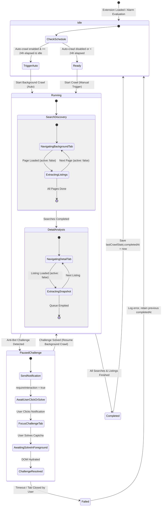

# Data Model: Automated Background Crawling and Human Challenge Notifications

**Feature Branch**: `010-background-crawl-automation`  
**Date**: 2026-11-10  
**Status**: Completed  

## 1. Storage Entities

### 1.1 CrawlConfig (Extension Local Storage: `config`)

Represents the persistent user configuration for crawl behavior, delays, and scheduling.

```typescript
export interface CrawlConfig {
  server_url: string;                 // URL of FastAPI backend (e.g. 'http://localhost:8050')
  human_like_enabled: boolean;        // Whether random mouse/scroll jitter is applied
  min_page_delay: number;             // Minimum delay between pages (ms)
  max_page_delay: number;             // Maximum delay between pages (ms)
  min_navigation_delay: number;       // Minimum delay between searches/listings (ms)
  max_navigation_delay: number;       // Maximum delay between searches/listings (ms)
  
  // NEW: Automated crawl scheduling
  auto_crawl_enabled: boolean;        // Enables automatic background crawl on 24h expiration (default: false)
  auto_crawl_interval_hours: number;  // Interval threshold in hours (default: 24)
}
```

#### Validation Rules
- `auto_crawl_enabled`: Boolean (required).
- `auto_crawl_interval_hours`: Integer $\ge 1$, default $24$.
- `server_url`: Valid HTTP/HTTPS URL string.

---

### 1.2 LastCrawlStats (Extension Local Storage: `lastCrawlStats`)

Persists the metrics and timestamp of the last complete crawl run.

```typescript
export interface LastCrawlStats {
  sessionId: number;                  // Identifier of completed crawl session
  totalProperties: number;            // Total property items captured/inspected
  pagesProcessed: number;             // Total search pages traversed
  searchesCrawled: number;            // Total saved searches processed
  completedAt: number;                // Epoch timestamp (ms) when full run completed
  trigger: 'manual' | 'automatic';    // Origin of the completed crawl
}
```

#### Validation Rules
- `completedAt`: Integer epoch timestamp $> 0$.
- `trigger`: Enum `'manual' | 'automatic'`.

---

### 1.3 ActiveChallengeState (In-Memory / Runtime State)

Tracks active anti-bot challenges currently requiring human resolution.

```typescript
export interface ActiveChallengeState {
  tabId: number;                      // Chrome tab hosting the challenge
  windowId: number;                   // Chrome window hosting the tab
  notificationId: string;             // Identifier of active Chrome desktop notification
  detectedAt: number;                 // Epoch timestamp when challenge was detected
  stage: 'search' | 'detail';         // Crawl stage during which challenge appeared
  url: string;                        // Challenged URL
  resolved: boolean;                  // Flag indicating if challenge was cleared
}
```

---

## 2. State Machine & Transitions

### Crawl Orchestration Lifecycle



### State Transition Invariants
1. **Focus Invariant**: In state `Running`, all tab operations (`chrome.tabs.create`, `chrome.tabs.update`) MUST have `active: false`. The user's active tab is never switched unless transitioning into or within `PausedChallenge` via explicit notification interaction or challenge resolution.
2. **Mutual Exclusion Invariant**: If `is_running === true`, no secondary crawl trigger (automatic or manual) can enter `Running`.
3. **Completion Invariant**: `lastCrawlStats.completedAt` is updated ONLY when the crawl reaches `Completed` state. If a crawl is aborted, times out, or fails during `PausedChallenge`, `completedAt` remains unchanged so the automated check will re-evaluate on the next opportunity.
