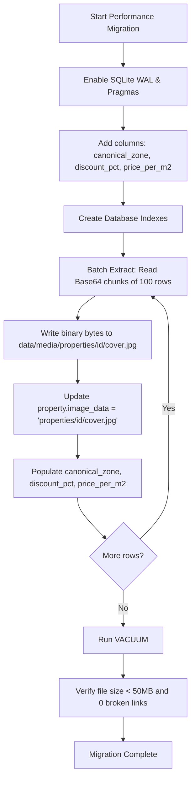

# Data Model & Schema Changes: Database Performance Optimization

**Feature Branch**: `011-optimize-database-performance`  
**Date**: 2026-11-13  
**Status**: Completed  

---

## 1. Entity: `Property`

### Schema Modifications

| Column | Type | Constraints / Indexes | Description |
|---|---|---|---|
| `canonical_zone` *(NEW)* | `VARCHAR(100)` | `NOT NULL`, `DEFAULT 'Burgos Centro / Otras Zonas'`, `INDEX` | Normalized canonical zone string for immediate SQL filtering without regex/string loops in Python. |
| `discount_pct` *(NEW)* | `FLOAT` | `NOT NULL`, `DEFAULT 0.0`, `INDEX` | Percentage discount from `original_price` to `current_price` (0.0 if no discount or increased). |
| `price_per_m2` *(NEW)* | `INTEGER` | `NULLABLE`, `INDEX` | Calculated square-meter price (`current_price / size_m2`). |
| `image_data` *(MODIFIED)* | `VARCHAR(500)` | `NULLABLE` | Stores relative disk path (`properties/{idealista_id}/cover.jpg`) instead of large Base64 text. |

### Indexes

```sql
-- Existing indexes retained
CREATE UNIQUE INDEX IF NOT EXISTS ix_property_idealista_id ON property (idealista_id);
CREATE INDEX IF NOT EXISTS ix_property_detail_status ON property (detail_status);
CREATE INDEX IF NOT EXISTS ix_property_status ON property (status);
CREATE INDEX IF NOT EXISTS ix_property_created_at ON property (created_at);

-- New performance indexes
CREATE INDEX IF NOT EXISTS ix_property_canonical_zone ON property (canonical_zone);
CREATE INDEX IF NOT EXISTS ix_property_discount_pct ON property (discount_pct);
CREATE INDEX IF NOT EXISTS ix_property_price_per_m2 ON property (price_per_m2);
CREATE INDEX IF NOT EXISTS ix_property_current_price ON property (current_price);
CREATE INDEX IF NOT EXISTS ix_property_status_canonical_zone ON property (status, canonical_zone);
```

---

## 2. Entity: `PropertyMediaAsset` (Filesystem Asset)

Visual media assets are managed on disk rather than inside database blobs.

### File Storage Convention

```text
data/media/properties/{idealista_id}/
├── cover.jpg               # Primary listing cover image (referenced by property.image_data)
└── gallery/                # Detailed gallery photos (referenced by property_photo.local_file_path)
    ├── photo_00.jpg
    ├── photo_01.jpg
    └── ...
```

### Safety and Validation Invariants
1. **Path Resolution Constraint**: Target path must resolve strictly within `data/media/`. Any path evaluation producing an ancestor directory (via `..`) is rejected.
2. **File Extension Whitelist**: Only `.jpg`, `.jpeg`, `.png`, and `.webp` extensions are permitted.
3. **MIME Mapping**: Media endpoints deduce MIME type from validated file extension (`image/jpeg`, `image/png`, `image/webp`).

---

## 3. Migration Plan (Data Transformation Lifecycle)


